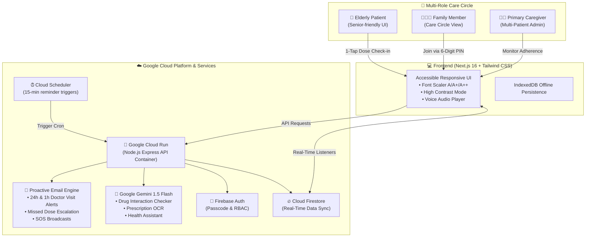

# 🏥 CareSync — Smart Elderly Care & Medication Management Platform

> Built for the **Google for Developers x MnM Catalyst Hackathon: PromptWars**  
> *"Going beyond basic reminders to build a smarter, more accessible, reliable, and collaborative healthcare ecosystem."*

[](https://deploy.cloud.run)
[](https://opensource.org/licenses/MIT)
[](https://cloud.google.com/run)
[](https://firebase.google.com)
[](https://deepmind.google/technologies/gemini)

---

## 🌟 Executive Summary

**CareSync** is a unified, accessible healthcare ecosystem designed specifically for elderly individuals, their family members, and medical caretakers. 

Unlike conventional reminder apps that leave elderly seniors isolated or place high cognitive burdens on users, CareSync introduces **passcode-based care circles**, **proactive multi-channel automated email reminders**, **Gemini 1.5 Flash clinical Q&A with voice playback**, **prescription label photo OCR**, and **missed-dose escalation alerts**.

---

## 🎯 Alignment with Catalyst Hackathon Scoring Criteria

| Scoring Metric | How CareSync Exceeds Expectations |
| :--- | :--- |
| **Problem Statement Alignment** | ✅ Passcode-based profile sharing, multi-role RBAC, medication CRUD, adherence tracking, proactive email reminders for missed doses & upcoming appointments. |
| **Google Services Usage** | ✅ **Google Cloud Run** (Dockerized deployment), **Cloud Firestore** (Real-time NoSQL database), **Firebase Authentication** (RBAC), **Google Gemini 1.5 Flash** (Clinical interaction checking & conversational health assistant), and **Google Cloud Scheduler** (Cron automated email triggers). |
| **Accessibility (Elderly Focus)** | ✅ Senior font scaler (`A` / `A+` / `A++`), WCAG High-Contrast Mode, large touch targets (tremor-friendly), and **Voice Text-to-Speech** for audio responses. |
| **Security & Privacy** | ✅ SHA-256 hashed 6-digit care circle passcodes, Firebase Token verification, granular Firestore Security Rules, environment secret segregation. |
| **Code Quality & Architecture** | ✅ Full TypeScript strict typing, clean separation of concerns (API routes, services, middleware, modular React components), Next.js 16 App Router. |
| **Efficiency & Reliability** | ✅ Scale-to-zero serverless Cloud Run containers, offline Firestore IndexedDB cache for low-connectivity environments. |

---

## 🏗️ Architecture Diagram



---

## ✨ Standout Features

### 1. 🔐 Passcode-Based Profile Sharing (Zero-Friction Care Circles)
* Elderly seniors or their primary caregiver can generate a secure 6-digit access PIN (e.g. `482910`).
* Family members or visiting nurses enter this PIN to instantly link into the patient's care circle without complicated permission handshakes.

### 2. 💊 Smart Medication Management & Refill Tracking
* Schedule multiple dose times per day (Morning, Afternoon, Evening, Bedtime).
* Color-coded medicine cards with pill stock tracking and automated **"Low Refill Alert"** triggers when supply drops below 20%.

### 3. 🤖 Google Gemini 1.5 Flash Integration
* **Clinical Drug-Drug Interaction Checker:** Analyzes all active prescriptions simultaneously to detect contraindications, dangerous food interactions (e.g., grapefruit with statins), and optimal meal timings.
* **Prescription Photo OCR (Gemini Vision):** Snaps a photo of a prescription label or medicine box and automatically parses the drug name, dosage, and frequency.
* **Conversational Health Assistant with Voice Playback:** Natural language answers to questions like *"Can I take Metformin on an empty stomach?"* with Text-to-Speech audio so seniors don't have to read small screens.

### 4. 📧 Proactive Multi-Channel Email Reminders
* **Scheduled Doses:** Sends gentle reminders before medication windows.
* **Missed-Dose Escalation Chain:** If a dose remains unconfirmed 30 minutes past its scheduled time, an escalation alert is automatically dispatched to family members.
* **Doctor Appointments:** Dispatches reminder emails **24 hours prior** and **1 hour before** scheduled clinical consultations.

### 5. 🆘 Emergency SOS Alert System
* Features a 5-second cancel countdown to eliminate false triggers caused by tremors.
* Simultaneously notifies all registered emergency emails and contacts with the patient's current active medication list and emergency notes.

---

## 🚀 Quick Start Guide (Local Development)

### Prerequisites
* Node.js v20+
* npm v10+

### 1. Clone & Set Up Frontend
```bash
cd caresync-frontend
npm install
npm run dev
```
Open [http://localhost:3000](http://localhost:3000) in your browser.

### 2. Set Up Backend API
```bash
cd caresync-backend
npm install
npm run dev
```
API runs on [http://localhost:8080](http://localhost:8080).

---

## 📦 Deployment to Google Cloud Run

Both the frontend and backend are fully containerized with multi-stage Dockerfiles optimized for Google Cloud Run:

```bash
# 1. Build and deploy backend to Cloud Run
gcloud run deploy caresync-backend \
  --source ./caresync-backend \
  --region us-central1 \
  --allow-unauthenticated \
  --port 8080

# 2. Build and deploy frontend to Cloud Run
gcloud run deploy caresync-frontend \
  --source ./caresync-frontend \
  --region us-central1 \
  --allow-unauthenticated \
  --port 8080
```

---

## 👥 Hackathon Team & Acknowledgements
Built with ❤️ for **Catalyst Hackathon: PromptWars** powered by Google for Developers.
Special thanks to the Google Antigravity & DeepMind teams for the agentic tooling.
